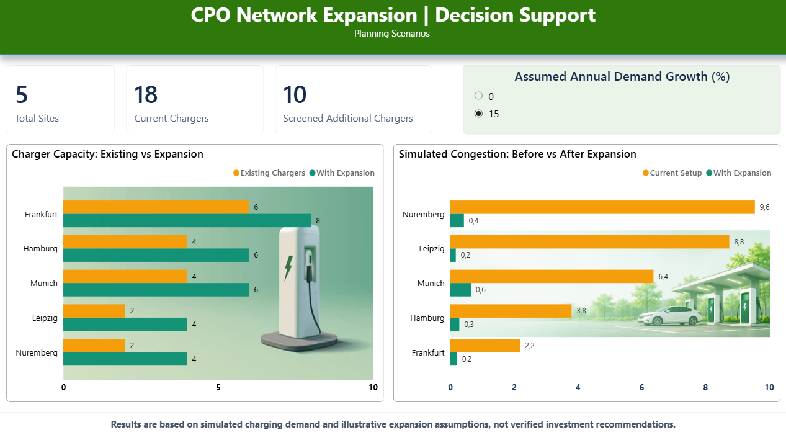
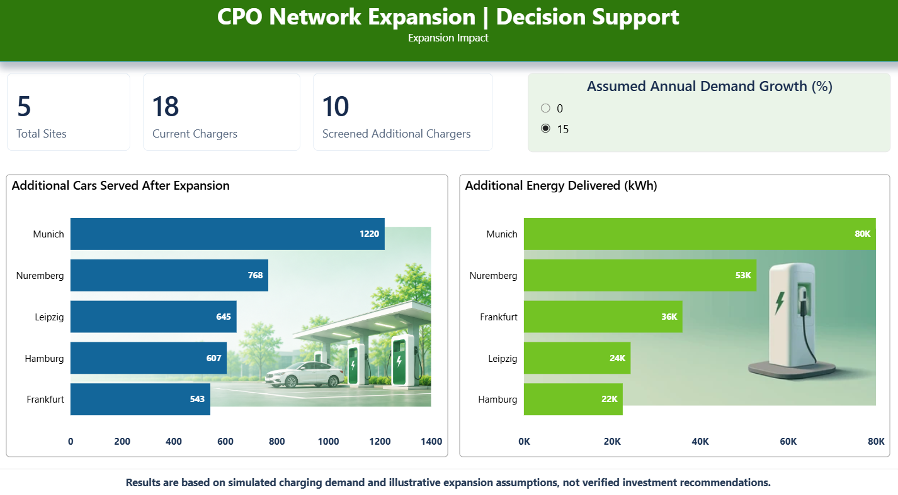
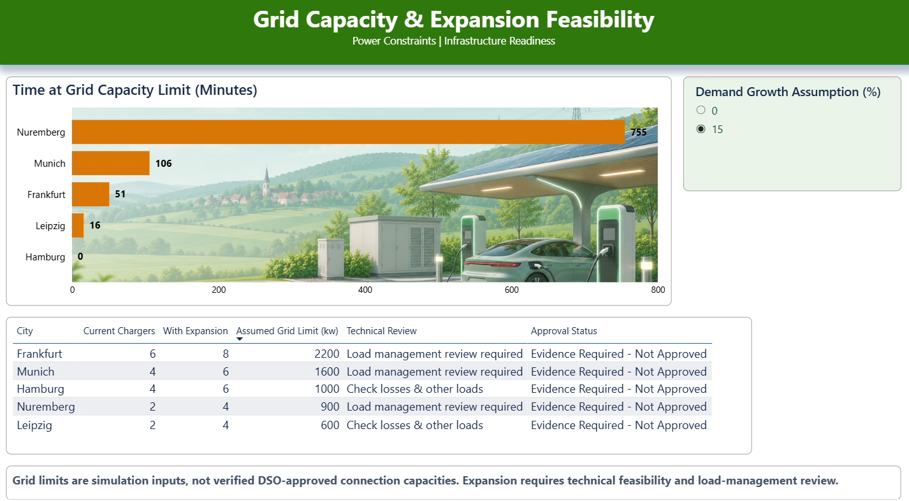
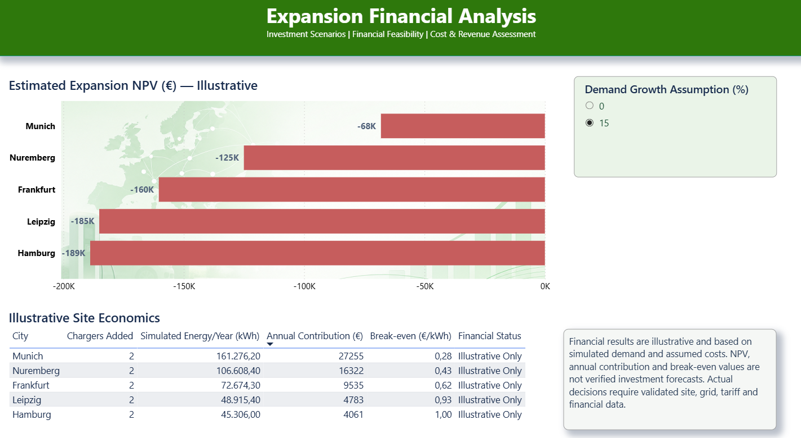
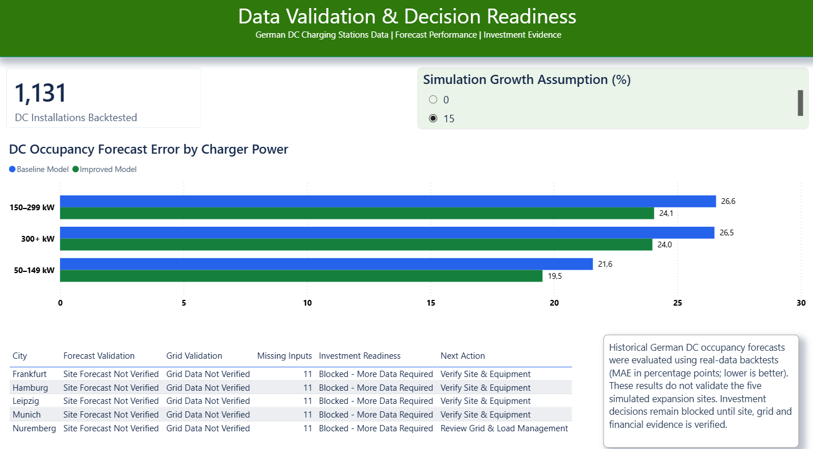

# CPO Network Expansion | Engineering Decision Support

**Germany-focused EV charging network planning prototype** | Python simulation, capacity screening, financial what-if analysis, real-data forecast benchmarking, and a five-page Power BI dashboard.

> **Engineering demonstration — not an investment recommendation.** The five planning sites and their charging demand are simulated. Grid limits, equipment assumptions, demand-growth scenarios, and economic inputs are not independently verified for actual construction or investment. Historical German DC occupancy backtests are a **separate dataset** and do not validate the five simulated expansion sites.

## Power BI Dashboard Preview

The five-page dashboard demonstrates how a CPO can evaluate charging network expansion, grid constraints, financial feasibility, and data readiness.

### 1. Network Overview


### 2. Expansion Impact


### 3. Grid Capacity & Feasibility


### 4. Financial Analysis


### 5. Data Validation & Decision Readiness


> **Note:** Expansion results are based on synthetic scenarios. Historical German DC occupancy backtests are separate from the simulated investment cases.


## What does the project answer?

For a charge point operator (CPO), adding charging units can improve service but might overload the grid or fail financially. This project demonstrates a structured screening process:

1. **Network overview:** Compare existing chargers with technically shortlisted expansion options and simulated congestion.
2. **Expansion impact:** Estimate additional charging sessions served and electricity delivered during the simulated test period.
3. **Grid & feasibility:** Check power constraints at site, charging-unit, connector, and shared-pool level; flag where grid/load-management evidence is missing.
4. **Financial analysis:** Compare *illustrative* expansion net present values (NPV), annual contribution, and break-even contribution per extra kWh.
5. **Data validation & readiness:** Report historical German DC occupancy forecasting backtests and show which site-specific evidence is still required.

The current demonstration compares **five synthetic sites**, with **18 existing physical chargers**, under **0% and 15% assumed annual arrival growth**. A physical charger and its connectors are modeled as distinct concepts; simultaneous connector use is limited by the configured charging unit, shared power pools, and site-grid constraints.

## Technical approach

| Component | Purpose |
| --- | --- |
| Synthetic charging sessions | Generate an example German charging network and historical demand attempts. |
| Asset registry | Describe physical chargers, connectors, charging power, shared cabinets/pools, and assumed grid imports. |
| Group-aware simulation | Compare current and expanded charging configurations using consistent vehicle arrival assumptions. |
| Growth-aware screening | Test conditional 0% / 15% annual demand growth without pretending to predict actual future site demand. |
| Feasibility and grid checks | Distinguish simulated power constraints from DSO-confirmed capacity and approval. |
| Financial what-if | Explore synthetic investment assumptions; do **not** treat demonstration costs or margins as operator quotes. |
| Real DC occupancy benchmark | Test forecasting approaches on historical German DC occupancy data, separately from synthetic scenarios. |
| Evidence-gated decision feed | Produce clear statuses and actions instead of automatic invest/no-invest conclusions. |

## Repository layout

```text
src/                         Python analysis, simulation, forecasting and auditing scripts
config/                      (If present) local settings
 data/
   raw/                      Small synthetic site metadata and locally generated sessions
   config/                   Charger, grid, and evidence configuration/templates
   external/                 External datasets kept locally; NOT in public Git
   processed/                Generated CSV results; NOT in public Git
 docs/                        Project notes and technical documentation
 outputs/                     Power BI report (inspect for embedded data/license constraints)
```

> The indentation above represents the project's top-level `data/` directory. Source data and generated files are intentionally not all tracked by Git.

## Local setup (Windows)

From the project root:

```bat
py -3.11 -m venv .venv
.venv\Scripts\activate
python -m pip install --upgrade pip
python -m pip install -r requirements.txt
```

If your existing `.venv` already works, you **do not** need to recreate it. The declared packages were successfully installed and imported in a fresh Python 3.11 virtual environment; see the reproducibility checks below.

## Reproducibility checks (verified November 2026)

The **synthetic demonstration workflow** has passed two separate checks:

- **Clean committed-snapshot pipeline check:** 13/13 synthetic steps completed in the existing working Python environment. The generated dashboard feed contained **10 rows**: five example sites under **0% and 15%** annual demand-growth assumptions.
- **Fresh Python 3.11 environment check:** A new virtual environment installed `requirements.txt`, passed `pip check` and package import checks, generated **62,039** simulated vehicle arrivals (**61,386** served sessions), and created **11** equipment scenarios across five sites. All **7/7** checks passed.

**Scope:** These checks establish that the core synthetic demo can be regenerated and its declared dependencies can be installed in a new environment. They **do not** establish that the full 13-step workflow was run from start to finish *inside that new environment*. The external German DC historical-data benchmark and the Power BI `.pbix` file were **not** independently reproduced by these tests. Licensed/external source datasets and machine-specific Power BI CSV paths may need to be supplied or adjusted locally.

The checked synthetic pipeline starts directly with `generate_sessions.py`, then uses the *already committed* demo asset configuration files. Running `prepare_cpo_asset_registry.py` is **not required** for a fresh clone and may refuse to overwrite existing registry files. Use the tested script order in the next section.

## Running the synthetic planning pipeline

The following is the **intended script order** for the synthetic scenario and evidence-gated decision feed. It depends on the example `data/raw/` and `data/config/` inputs being present. Review the configuration files before running; these steps write to `data/processed/` and may update demo outputs.

```bat
python src\generate_sessions.py
python src\generate_network_scenarios.py
python src\simulate_registry_network.py
python src\simulate_growth_aware_network.py
python src\build_evidence_based_demand_inputs.py
python src\build_future_expansion_decision_inputs.py
python src\build_technical_expansion_shortlist.py --max-rejected-pct 2
python src\build_cpo_site_feasibility.py
python src\check_grid_upgrade_value.py
python src\build_cpo_technical_decision_table.py
python src\run_cpo_financial_sensitivity.py --demo
python src\prepare_cpo_operator_evidence_intake.py
python src\build_cpo_decision_dashboard_feed.py
```

**Important:** The `--max-rejected-pct 2` value above is an example operator-selected *screening threshold*, not an industry standard. `--demo` intentionally uses fictional financial assumptions; it must never be interpreted as a financial estimate for real installations. This run sequence passed a **13-step synthetic clean-snapshot test** using the existing Python environment; see the reproducibility checks above.

The main Power BI input is:

```text
data/processed/cpo_decision_dashboard_feed.csv
```

The real-data occupancy forecast chart uses a different derived input:

```text
data/processed/real_dc_2026_improved_summary.csv
```

These CSVs are not committed automatically because `data/processed/` is ignored. To open the `.pbix` report on a different machine, regenerate the required inputs or supply appropriately licensed local copies and update the Power BI file paths. The dashboard may otherwise show refresh errors.

## Historical German data: separate analysis

The project includes optional scripts for external German charging infrastructure and historical occupancy/session analyses. Some inputs are sizeable and may be subject to redistribution restrictions. Do not commit `data/external/` to a public repository without checking permissions.

The occupancy comparison shown in Power BI reports a mean absolute error (MAE) in **percentage points**, where smaller is better. The historical dataset contains **1,131 DC installations in the current dashboard's backtest display**; confirm the distinct-installation definition against the source data before using this number in a public claim. Do not infer real-site arrival rejection rates from successful charging-start records.

An end-to-end *consistency* audit is available:

```bat
python src\audit_cpo_end_to_end.py
```

Run it **only after** all of its required synthetic and real-session evidence/forecast CSVs have been produced. It checks internal accounting and evidence gating, not whether the forecasts or returns are accurate for real sites.

## Findings and boundaries

- Charger expansion can reduce the **simulated** fraction of attempted charging sessions that cannot start.
- More sessions and energy do **not** automatically imply attractive investment returns.
- Equipment DC nameplate power is **not** a DSO-approved AC grid import limit.
- NPV and break-even values depend on **illustrative** costs, tariffs, discount rates, and operating assumptions.
- Without verified operator demand, site identities, connection contracts, actual charger characteristics, operational uptime, and commercial evidence, the project deliberately **blocks investment approval**.
- The historical real-data forecasts and synthetic planning scenarios are **not site-matched or interchangeable**.

## Power BI pages

1. **Network Overview**
2. **Expansion Impact**
3. **Grid & Feasibility**
4. **Financial Analysis**
5. **Data & Decision Readiness**

The finished dashboard is stored locally in `outputs/` as a `.pbix`. Before publishing that binary, review its embedded data, provenance, and sharing rights; it can contain imported source records or cached values even when source CSVs are ignored by Git.

## Data protection and attribution

This repository does not provide third-party raw datasets, confidential operator records, site-identifying customer data, or a verified model of a real CPO network. Check source licenses and include appropriate attributions before publishing any derived statistics or screenshots. Anonymized source labels should not be mapped to actual sites without documentary evidence.

## Project status

- Python pipeline and Power BI engineering demonstration developed.
- Older experimental scripts archived locally; local archives, test fixtures, virtual environments, and processed data excluded from public Git.
- **Synthetic demonstration verified:** 13/13 steps passed in a clean committed snapshot; 7/7 fresh-environment checks passed. External real-data benchmarking and Power BI refresh still require separate validation.
- Planned next step: a focused Streamlit application that makes scenario exploration interactive rather than merely replicating Power BI charts.
